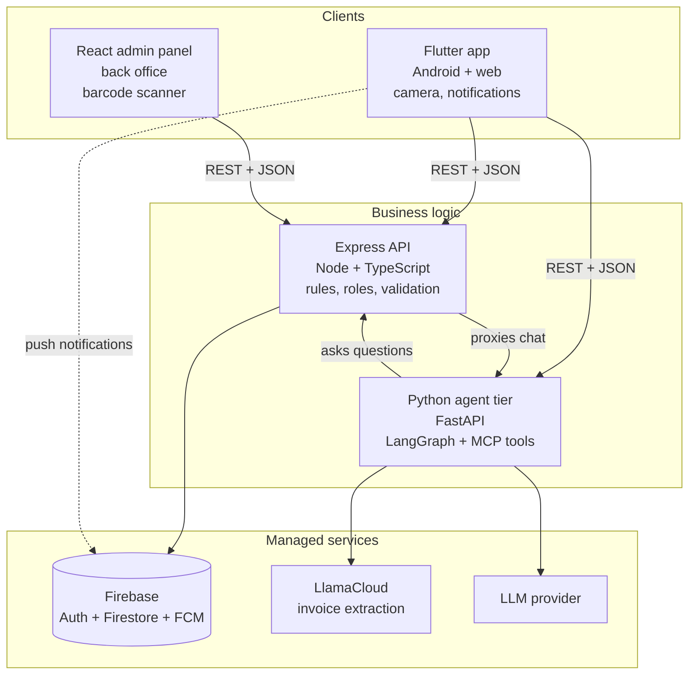
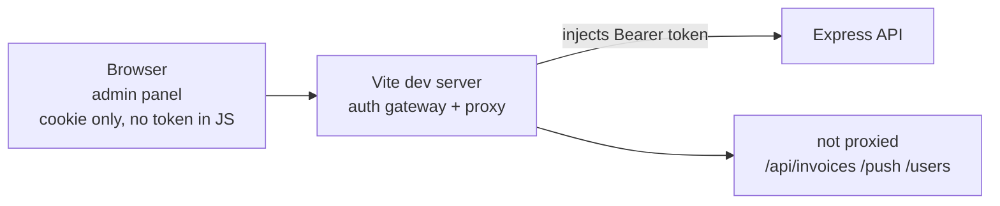
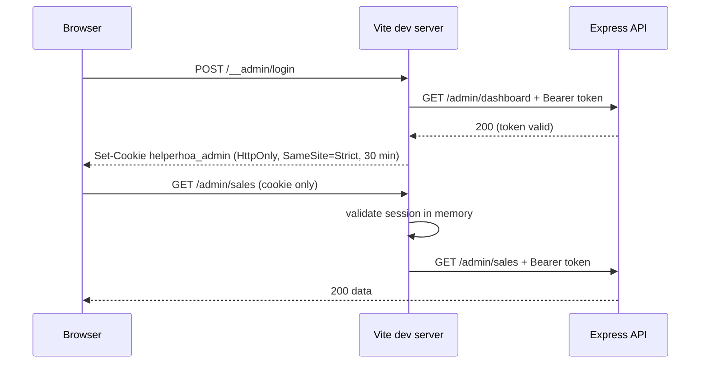
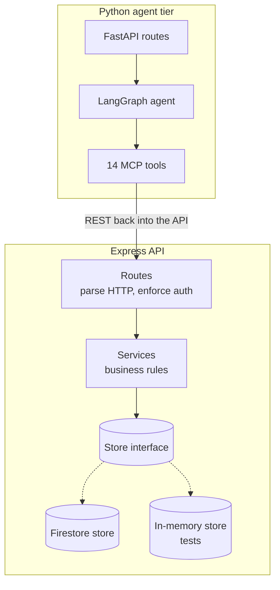
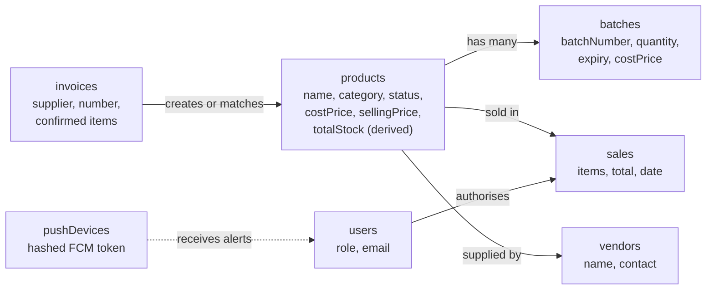
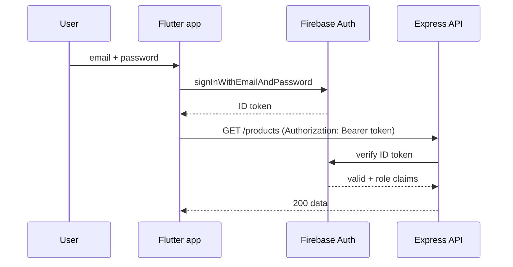
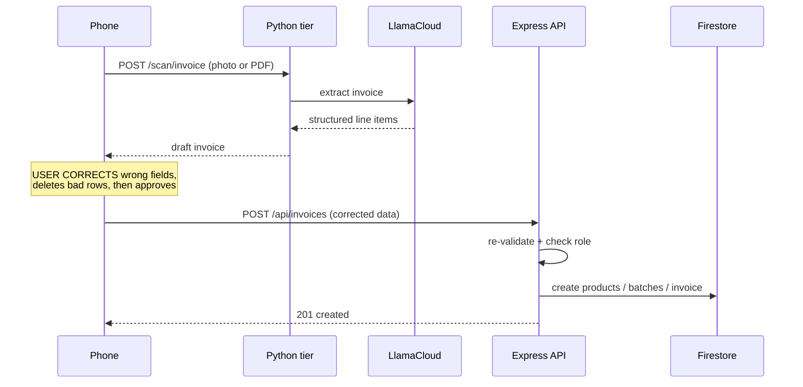
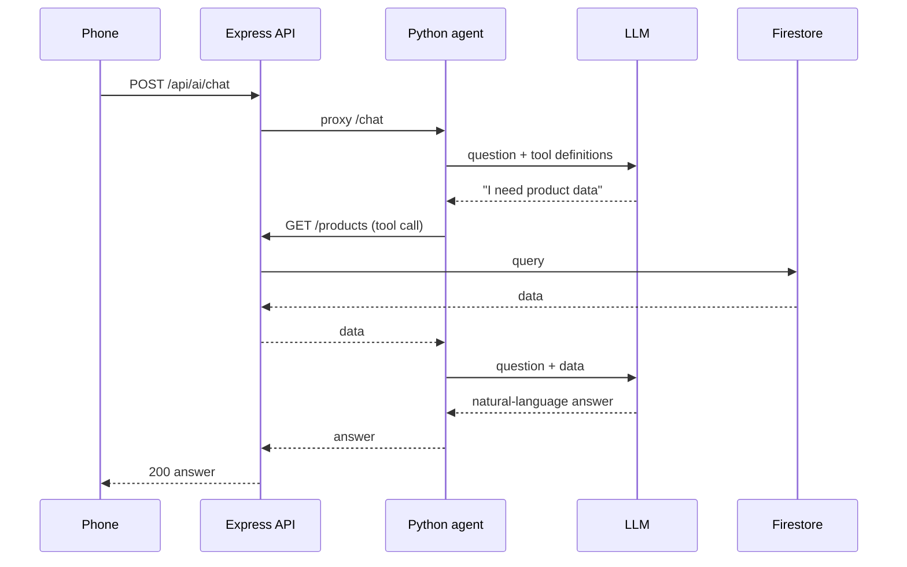
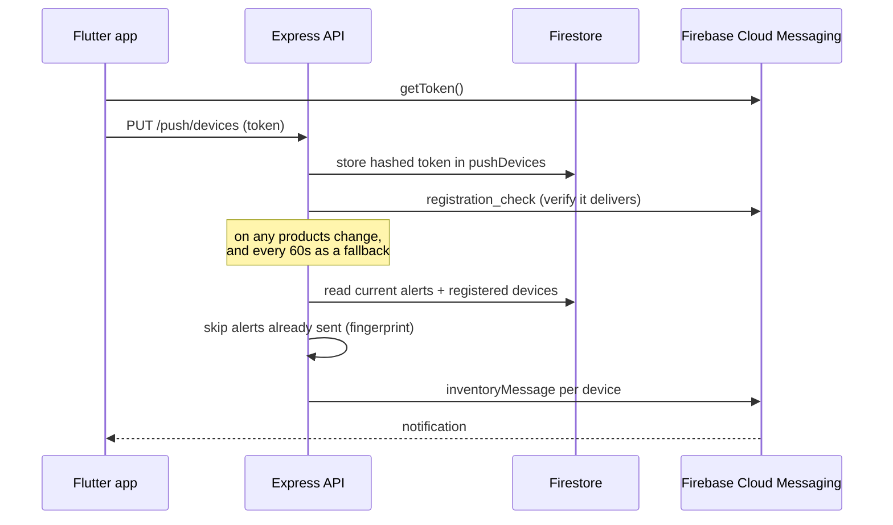

# Architecture and Design Decisions

HelperHOA — a stock and sales system for a home-improvement retailer.

This document explains **how the system is put together and why each decision was made**. It is written for a reviewer who has not seen the code: every choice is stated with the alternative it beat.

---

## 1. The problem, and the shape of the answer

A small retailer has stock arriving from suppliers and sales leaving the counter. Two realities shape everything:

- **Stock arrives on paper.** Invoices arrive as PDFs or phone photos. Reading them is slow and error-prone.
- **Stock is perishable.** Ink, adhesives and sealant expire. Over-ordered stock becomes waste.

So the system has three jobs: record what arrived, record what sold, and warn before stock runs out.

That leads to four pieces of work — a **mobile app** for the shop floor, a **web admin panel** for the back office, an **Express API** holding the business rules, and an optional **Python agent tier** that reads invoices and answers questions in natural language.

---

## 2. System overview

One diagram first, then detail.

**Read it as two paths.** The solid path `Clients → Express → Firebase` is the product: it holds all business rules, all authorisation, and all data. It is deployed and running. The Python tier is an *addition*, reachable only through the API — the core system works if Python is switched off entirely.

---

## 3. Why two clients

The same business, two working contexts that do not suit one interface.

| | Flutter mobile app | React admin panel |
|---|---|---|
| User | Shop-floor staff, one-handed, standing | Manager at a desk |
| Stock intake | Camera → scan → review | Barcode scanner → instant lookup |
| Backend | Express + Python | Express only |
| Identity | Real per-user sign-in | Shared admin token (§10) |
| Offline needs | Wanted but not built (§7.2) | None |

The split is deliberate: the admin panel needs a **desktop barcode scanner**, which phones do not have; the phone needs a **camera and notifications**, which desktops do not need. Both talk to the same Express API, so there is exactly one set of business rules.

---

## 4. How the web client shapes the backend

The admin panel is not a passive consumer of the API. Its development server sits **in front of** the API and changes what the backend has to support. This is the least obvious coupling in the system, so it is documented explicitly.

Only the routes the proxy forwards reach the API; everything else stops at the gateway.

### 4.1 The panel cannot hold a token

A browser application cannot keep a bearer token secret: anything in JavaScript is readable by the user and by any script on the page. So the panel never receives one. Instead the **Vite dev server** holds a long-lived admin token, loaded once from `.env` at startup, and injects it into every upstream request.

The browser only ever holds an opaque session cookie.

### 4.2 The login exchange

On sign-in the dev server validates the configured token by calling `/admin/dashboard` with it. Only if that succeeds does it mint a session: **32 random bytes**, hex-encoded, stored in an in-memory `Map`, and returned as an `HttpOnly; SameSite=Strict` cookie with a 30-minute lifetime. Because the cookie is `HttpOnly`, page scripts cannot read it; because it is `SameSite=Strict`, other origins cannot send it.

Every subsequent request to a protected path is checked against that `Map` before being proxied. An absent or expired session is refused with `401` and never reaches Express.

### 4.3 What this means for the backend

Three consequences follow, and they are the reason this section exists:

**Only three route families are reachable.** The dev server proxies exactly `/admin`, `/products` and `/inventory-alerts`. Anything else — `/api/invoices`, `/push`, `/users`, `/auth`, `/api/ai` — is not proxied and returns `404` to the browser. This is why the panel appears to have no invoice or notification features: the gateway cannot reach them, not because the API lacks them.

**The panel is permanently an admin.** It holds one token with one identity. A manager or cashier cannot be represented through it, which is consistent with it only ever calling admin-gated routes such as `POST /admin/sales`.

**The panel is a local development tool.** The entire gateway lives in Vite's `configureServer` hook, which runs *only* in the development server. A production build has no middleware, no login and no session — and `render.yaml` defines just the one Express service. The panel cannot be deployed as it stands.

### 4.4 The requirement this placed on the API

For the gateway to work at all, the API had to be **stateless and Bearer-only**: it must accept an identity from an `Authorization` header and hold no sessions of its own. That constraint is a good property for a horizontally-scaled API, so the web client imposed a requirement the backend would have wanted anyway.

---

## 5. Internal structure

How each tier is layered, and why.

**Every tier has the same shape: routes → logic → storage.** Routes never contain business rules; services never touch HTTP. This is what lets the store be swapped — the in-memory store runs the 32 server tests with no Firebase credentials, so tests are fast and hermetic.

**The agent calls back into Express rather than into Firestore.** The Python tools are HTTP clients of our own API. This is the single most important boundary in the design: it means the LLM cannot reach data except through the same role checks and validation as the apps. An agent cannot read data a cashier could not.

---

## 6. Data model

**Stock lives in two places on purpose.** A `product` is the catalogue entry and carries `totalStock` — explicitly *derived* state, recomputed from its batches rather than an independent counter that could drift. A `batch` is one physical delivery with its own quantity, cost and expiry. Expiry cannot live on the product: a shop stocks three deliveries of the same paint with different expiry dates. A single stock number per product would be a lie.

`products` is queried with a `status` filter combined with a `name` sort, which Firestore will only serve from a [composite index](https://firebase.google.com/docs/firestore/quotas#indexes). That index is declared in `firestore.indexes.json` and must be deployed before the alerts route returns data.

---

## 7. Request lifecycles

Five flows, each showing where a decision bites.

### 7.1 Sign in

The app **never handles a password** — Firebase verifies it and returns a token. The API re-verifies that token on every request rather than trusting the client. This is why an unauthenticated request is refused with `401` rather than being served. The admin panel's entirely different exchange is in §4.2.

### 7.2 Reading stock

`GET /products` requires a token. The home screen loads products on open and offers pull-to-refresh (`RefreshIndicator`). There is **no offline cache**: with no connection the screen shows an error rather than stale data.

### 7.3 Recording a sale

Sales are recorded inside a **Firestore transaction** — stock is decremented and the sale document is written together, so two simultaneous sales cannot both succeed against the same units.

The web client is used for sales and stock updates. A recorded sale reduces that product's stock; once it reaches the reorder point the product is flagged on the dashboard and in the product list, and staff are notified until the item is restocked.

There are two entry points, with deliberately different reach:

| Endpoint | Client | Roles |
|---|---|---|
| `POST /products/:id/sell` | API surface for the shop floor | admin, manager, **cashier** |
| `POST /admin/sales` | React admin panel | admin |

Both delegate to the same service method and the same transactional store code, so the rule is enforced in one place. The cashier-facing route is open to all three roles because selling is the cashier's core task; the admin panel sits behind the stricter admin gate. Note that only `POST /admin/sales` validates its payload before use — `/:id/sell` destructures without checking types, the same gap described in §17.

**The Flutter Sell screen does not yet call either endpoint** — it holds in-memory values only. The sale path is complete and working in the admin panel; the mobile screen is the gap, and it is listed again under known debt (§17).

### 7.4 Invoice approval — the three-tier flow

This is the most involved flow, and the diagram shows why the edit step exists.

Note the arrow that goes **back to the phone** before anything is stored. Extraction is probabilistic, so the user's correction is the last checkpoint before the ledger changes. See §8.2.

### 7.5 Chat with the agent

The user sends one HTTP request. The agent's tool calls happen **server-side**, so the phone makes one call, not four. The tools are read-only (§9.2), so an LLM mistake can misreport a number but cannot corrupt data.

---

## 8. Interface decisions

### 8.1 Why cards, not a list

Both appear in the app. Cards were chosen for product and alert surfaces; lists were kept where they earn their place.

**Why cards win for products:**

- **Cards hold varied information at once.** A product needs name, category, stock level, price and a status warning. A list row forces that into one cramped line; a card gives each fact its own line with room to breathe.
- **Status needs to be visible per item.** Low-stock and expiry warnings are colour-coded. A card has a header area where the badge sits next to the name; a `ListTile` forces the badge to the trailing edge, where it is easy to miss when scanning.
- **Row heights are not uniform.** Some products carry an extra warning line. Cards handle variable height naturally; a `ListTile`-based list assumes one line and ends up with cramped or uneven spacing.
- **Touch targets.** Card padding makes the whole card tappable. A dense list invites mis-taps — costly when the tap triggers a stock edit.

**The honest cost:** cards use more vertical space, so fewer items fit per screen. That is acceptable here because the catalogue is small (~13 products) and the user needs to *read each item*, not skim a long list. Density would be the right trade for thousands of SKUs — a scale we do not target.

**Where lists are still correct:** the chat transcript (chronological, variable-length, uniform chrome is noise) and invoice line items (tabular numbers that must align in columns, where grouping matters less than alignment).

### 8.2 Why invoice approval is editable

Extraction is a probabilistic process — it misreads totals, merges two lines, or misses an item entirely. Submitting a scan directly to the database would let a misread become permanent stock data.

So the flow puts a **deliberate human checkpoint between extraction and storage**:

- The user corrects supplier, invoice number and date, and each line's product, quantity, cost and sell price.
- Rows can be **deleted** — a scanned line that is not real stock is worse than a missing one. (Rows cannot be *added*: the invoice's contents are the source of truth, so correcting a misread means editing or removing, not inventing.)
- **Nothing is written until Approve is tapped.** The write is caused by an explicit user action, not by the scan finishing.
- **The server validates again** on arrival. Client-side checking is convenience, not security.

This converts an unreliable automated step into a reliable system: automation does the tedious reading, the human does the judgement.

---

## 9. The agent and its tools

### 9.1 What the agent is

A LangGraph agent with **14 MCP tools**, all read-only, exposed to the LLM as callable functions. The model decides which to call based on the question.

| Tool | Answers |
|---|---|
| `list_products`, `get_product` | What is in stock? |
| `low_stock_products`, `out_of_stock_products` | What needs reordering? |
| `fast_moving_products`, `slow_moving_products` | What is turning over, and what is stuck? |
| `top_selling_products`, `top_profit_products` | What earns the most? |
| `category_breakdown`, `inventory_value` | Where is the money? |
| `expiring_stock`, `aging_stock` | What is about to be written off? |
| `stock_alerts_summary`, `restock_suggestion` | What should I do next? |

### 9.2 Why these tools are safe

**Every tool is read-only.** There is no tool that creates, edits or deletes stock. A wrong LLM answer can produce a wrong number in a chat reply; it cannot write to the database. This is a deliberate design constraint, not a limitation we ran into — an assistant that can mutate inventory is unsafe to give to a shop floor.

**MCP as the protocol.** The tools are defined once as MCP tools and are callable by any MCP-compatible client, rather than being Python functions welded to one chatbot. The agent is the first consumer, not the only one.

---

## 10. Identity, roles and tokens

Two clients, two deliberately different identity models, one enforcement point.

### 10.1 The role model

| Role | Intended access |
|---|---|
| `admin` | Everything, including `/admin/*` and staff management |
| `manager` | Stock intake, invoice approval, catalogue |
| `cashier` | Sell and read |

Enforcement is two middleware applied per route: `requireAuth` verifies the Firebase ID token, then `requireRole([...])` checks the role. Applied consistently this way, a route's protection is stated in one visible place rather than scattered through handlers.

`/admin` is mounted behind `requireRole(['admin'])` for the entire router, which is why a cashier or manager receives `403` from any admin route — including the sale endpoint the panel uses (§7.3).

### 10.2 How each client manages its token

| | Flutter app | React admin panel |
|---|---|---|
| Credential | Email + password per user | One static token from `.env` |
| Identity | A real user | One shared admin |
| Held in app memory | Yes, as a bearer token | **Never** — cookie only |
| Refresh | Firebase SDK refreshes silently | None; 30-minute session, then sign in again |
| Expiry handling | SDK handles it | Session expiry returns `401` |
| Can represent cashier/manager | Yes | No |

**Why the mobile app can be trusted with a token.** A native app stores its token in app-private memory and talks to a fixed, known backend. There is no browser to steal it from and no page for an injected script to read it from.

**Why the browser cannot.** Anything in page JavaScript is readable by the user and by any script that reaches the page. Putting a Firebase token in `localStorage` would be the usual shortcut and would be a genuine vulnerability — an XSS bug becomes a credential leak. Instead the token stays server-side in the dev-server gateway (§4.1) and the browser holds only an `HttpOnly` session cookie that JavaScript cannot read.

### 10.3 Defence in depth

The API never trusts a client's claim about who it is. Even the panel's request, which arrives with a valid `Authorization` header, is re-verified against Firebase on every call, and the role is then read from the verified claims rather than from anything the client sent.

---

## 11. Notifications

Stock warnings have to reach someone who is not looking at the app, so they are pushed rather than polled by the client.

### 11.1 The flow

### 11.2 Registration

The app registers its FCM token with `PUT /push/devices`. The server stores it in the `pushDevices` collection using the **SHA-256 hash of the token as the document ID**, so the stored tokens are not usable if the collection is ever read. Registration is a transaction, and the server immediately sends a `registration_check` message to confirm the token actually delivers before trusting it.

### 11.3 What triggers a send

Two triggers, deliberately:

- **A Firestore `onSnapshot` listener on the `products` collection**, for immediate reaction.
- **A 60-second interval**, as a safety net if the listener fails.

The listener is the better trigger because it is **reactive to the data, not to the endpoint**. A stock change made through the API, the admin panel, the invoice flow, or a direct database edit all produce the same event, so no write path can forget to notify. The interval exists only to guarantee eventual delivery; the code comment says so explicitly.

Scans are re-entrancy-safe: a scan already in progress is not restarted, and requests arriving during one are coalesced into a single follow-up pass rather than queued.

### 11.4 Not sending the same alert twice

A push that repeats is noise, and noise gets dismissed. Each alert is reduced to a **fingerprint** of the values that matter — stock level, expiry proximity, severity. If a device's stored fingerprint for that product matches the current one, the send is skipped.

Three details make this robust:

- **Stale tokens self-heal.** If FCM rejects a token as invalid, that device record is deleted, so dead tokens stop being retried.
- **Transient failures are retried.** If a send fails for a temporary reason, the previous fingerprint is kept, so the next scan tries again. Only a confirmed change is recorded as delivered.
- **Only staff are targeted.** Device lookup filters to accounts holding `admin`, `manager` or `cashier`, so a customer account never receives internal stock alerts.

---

## 12. Security

| Area | Measure | Why |
|---|---|---|
| Authentication | Firebase ID tokens, re-verified per request | Passwords never reach our server |
| Authorisation | Role gate per route: `admin`, `manager`, `cashier` | Least privilege — a cashier cannot approve invoices or open admin |
| Browser sessions | `HttpOnly; SameSite=Strict` cookie, 256-bit random ID | Page scripts cannot read or forge it |
| Secrets | Service account and `.env` gitignored; Render secret file | No credentials in the repository |
| CORS | Explicit origin allowlist | Unknown origins are rejected, not ignored |
| Push tokens | Stored as SHA-256 hashes | A leaked collection is not a list of live devices |
| Agent | Read-only tools | An LLM cannot corrupt data |
| Validation | Re-validate on arrival | Malformed input is rejected at the boundary |

**Known gaps, stated plainly.** No rate limiting and no security-header middleware (`helmet`) are configured. On a single-tenant internal tool this is tolerable; on a public deployment these are the first things to add.

---

## 13. Protocol choices

**REST + JSON, not GraphQL.** Our screens map to whole resources (products, sales, invoices), and a dashboard fetches several of them. REST with plain HTTP caching covers this. GraphQL would add a schema layer and a query-planning cost for no request-shaping we actually need.

**REST, not WebSockets.** Nothing here is a live feed. Stock and alerts are read on demand; updates arrive as **push**, which is the right tool for "tell the phone something changed" without holding a connection open.

**One request per chat answer, not streaming and not polling.** The phone issues a single `POST` and waits for one complete reply. Streaming would improve perceived latency on long answers, but these replies are a few sentences, so it would add protocol complexity for no perceptible gain. The agent's *internal* tool calls are absorbed server-side (§7.5), which is the latency that actually matters here.

**Same-origin requests from the browser.** The panel calls relative paths (`/admin/sales`) rather than an absolute API URL, so the dev-server gateway can intercept them. The alternative — calling the API cross-origin — would require the token in page JavaScript, which §10.2 explains is exactly what we refuse to do.

---

## 14. Scaling

Sized honestly for a single small retailer, with the limit stated:

| Layer | Behaviour | First limit reached |
|---|---|---|
| Express | Stateless; scales horizontally | Node event loop on a single core |
| Firestore | Managed, scales automatically | Document reads per second (plan limit) |
| Python agent | **Single instance, stateful** | Memory — LangChain + LangGraph needs ~2–3 GB |
| Clients | Stateless | Network |

**The Python tier is the constraint and is deliberately kept off the critical path.** It needs far more memory than the Express tier, so it is deployed separately (or not at all). Because every business rule lives in Express, scaling means scaling Express, and the agent tier can be resized, replaced or removed without touching the product.

**The web panel's session store does not scale, by design.** Sessions live in one dev-server process's memory (§4.2), which is fine for one developer at a time and is the reason the panel cannot be deployed as-is. A real deployment would move that session to a shared store, or replace it with Firebase Auth in the browser plus a short-lived in-memory token.

**Read-heavy scaling.** Stock reads dominate. Firestore handles this directly; the composite indexes in `firestore.indexes.json` keep queries off full-collection scans.

---

## 15. Deployment

**Express runs on Render** as a single service defined in `render.yaml`.

**Why not the alternatives.** GitHub Actions are ephemeral and stop after a job. Codespaces stop when idle and bill a personal quota. Cloud Run was the previous target and was dropped because the free tier's cold starts and networking model suited the app poorly compared with a long-lived Render service. Render gives a stable URL, TLS and a restart policy for free.

**What is deployed.** Only the Express service. The React panel is a local development tool (§4.3) and the Python tier is excluded on memory grounds (§18).

**Secrets never enter the repository.** The service account is supplied as a Render secret file; the app validates required configuration at boot and fails with an actionable message rather than a stack trace.

**Build-time client configuration.** The app's backend URL is a compile-time override (`--dart-define`), so the same source builds against local or hosted backends without code changes.

---

## 16. Mobile and device capabilities

| Capability | Where | Library | Central to the experience? |
|---|---|---|---|
| Document camera | Flutter | `image_picker` | **Yes** — stock intake starts by photographing an invoice |
| File selection | Flutter | `file_picker` | **Yes** — invoices often arrive as PDFs |
| Push notifications | Flutter | `firebase_messaging` | **Yes** — low-stock and expiry warnings |
| Barcode scanning | Web admin | `@zxing/browser` | **Yes** — instant stock lookup on the counter |
| On-device OCR | Flutter | ML Kit | No — evaluated and rejected (§16.2) |

### 16.1 Camera, two different jobs

Both clients use a camera, for different purposes, and this is worth separating because the design consequences differ.

**Document capture (mobile).** The Snap screen offers *Take Photo* (`ImagePicker` with `ImageSource.camera`) and *Browse* (`file_picker`, restricted to PDF and image formats), because an invoice may be photographed at the counter or forwarded later as a file. Whichever route is used, the bytes go straight to the Python tier for extraction and are then **discarded** — nothing is written to device storage and no copy is kept. That is a deliberate privacy choice: invoices contain supplier pricing, and there is no reason to retain an image once its contents have been read.

**Barcode capture (web admin).** The panel reads a product barcode with `@zxing/browser`, decoding from the device's video stream. On a successful read the dialog closes, populates the SKU field and looks the product up directly — turning a search box into a point-and-shoot action. Three details make it usable rather than a demo:

- The dialog is **lazy-loaded** (`React.lazy` + `Suspense`), so the camera code is not in the initial bundle and a user who never scans never downloads it.
- Camera failure is handled as a **normal state**, not a crash: a denied permission or an occupied camera shows an inline message and leaves manual SKU entry available.
- The stream is **torn down on unmount** (`controls.stop()`), with a cancellation flag so an in-flight decode cannot reopen the camera after the dialog closes.

### 16.2 On-device OCR: evaluated and rejected

We implemented on-device text recognition with ML Kit, then **removed it from the live path**.

The reason is empirical: on-device OCR is not reliable across our real input. **Some PDFs do not extract correctly** — scanned and mixed-quality documents fail where a cloud extraction model succeeds. Because a silent misread becomes wrong stock data, an unreliable parser is worse than a slower reliable one.

The code is retained as `invoice_ocr_service.dart` because it remains a viable **offline fallback for the inputs it does handle**, and because the evaluation is part of the design history.

### 16.3 Deliberately not included

Location, Bluetooth, NFC, biometrics and motion sensors are absent. None serves the three core jobs — record intake, record sales, warn about stock — and each would add a permission prompt, a store policy question and code that does not earn its place. Shipping an unused capability to appear well-equipped is a cost, not a feature.

---

## 17. Engineering practice

**Structure.** Layered consistently across all three codebases: routes → services → storage in Express; screens → services → models in Flutter; screens → API client in React. Business logic sits in one layer, not scattered through UI code.

**Static analysis.** Dart uses `analysis_options.yaml`; the React admin panel uses ESLint. **The Express server has TypeScript `strict` mode but no ESLint configuration** — a gap, and the most worthwhile single improvement to this codebase.

**Testing.** 32 server tests run against an in-memory store, needing no cloud credentials. The admin panel has API and component tests, including coverage of the proxy behaviour. Flutter has API-config and service tests. The server suite passes cleanly; a small number of pre-existing Flutter invoice-review tests fail and are unrelated to the architecture described here.

**Documentation.** This document covers architecture and decisions. `docs/HOSTING.md` covers deployment, and `live_testing.md` covers how to test the running system.

**Secrets hygiene.** `.gitignore` excludes `.env` files and `service-account.json`; the service account is supplied at runtime, never committed.

**Known debt, stated plainly:**

- `invoice_ocr_service.dart` is retained but unreachable (§16.2)
- `.gitignore` contains duplicated rule blocks
- The largest UI file is 705 lines and would benefit from decomposition
- The Express server lacks a linter
- **The app's Sell screen does not call any sale endpoint** — `POST /admin/sales` (admin panel) and `POST /products/:id/sell` (API) are both complete on the server, but the Flutter screen holds in-memory values only (§7.3)
- `POST /products/:id/batches` returns `500` rather than `400` for a malformed body — the route forwards its payload without validation, unlike its siblings
- `POST /products/:id/sell` destructures its body without type checks, unlike `POST /admin/sales`
- **The admin panel cannot be deployed** — its entire login and session layer is Vite dev-server middleware (§4.3)

---

## 18. Decision summary

| Decision | Alternative rejected | Reason |
|---|---|---|
| REST + JSON | GraphQL | No request-shaping need; adds a schema layer |
| Push notifications | WebSockets | Events are not a live feed |
| Two clients | One responsive app | Scanner needs desktop; floor use needs mobile |
| Express holds all rules | Rules split per tier | One set of rules, testable without cloud |
| Agent reads via our API | Agent reads Firestore directly | Agent inherits role checks; cannot bypass them |
| Read-only agent tools | Writable tools | An LLM must not mutate inventory |
| Human approval gate | Auto-commit scans | Extraction is probabilistic; wrong data is costly |
| Cards for products | Dense list | Items must be read, not skimmed |
| Cloud extraction (LlamaCloud) | On-device OCR (ML Kit) | Some PDFs fail local OCR |
| One request per chat answer | Streaming / polling | Replies are short; tool calls absorbed server-side |
| Cookie session via a server-side gateway | Token in `localStorage` | Page scripts must never hold a credential |
| Fingerprinted push dedupe | Send on every poll | Repeated alerts are noise and get dismissed |
| Render hosting | Actions / Codespaces / Cloud Run | Need a stable, long-lived URL |

---

## 19. Known limitations

**The Python tier is not deployed.** It needs more memory than the free hosting tier provides, so the invoice scanner and the chat assistant do not function on the public URL. Both are implemented and verified locally. No other feature depends on the Python tier — stock, sales, users, vendors and notifications all run entirely on Express and Firestore, so switching the agent tier off costs nothing else.

**The admin panel is a local development tool.** Its authentication and session handling exist only inside the Vite development server, so it is served by `npm run dev` and is not deployed. Only `/admin`, `/products` and `/inventory-alerts` are reachable through it (§4.3).

**The mobile Sell screen is not wired to the API.** Sales work end-to-end in the admin panel; the Flutter screen is a UI prototype (§7.3). Of the three jobs set out in §1, "record what sold" is therefore complete on the server and in the admin panel, but not yet on mobile.

All three are stated here rather than buried, because a reader deciding whether to trust this system should find them in the summary rather than discover them later.